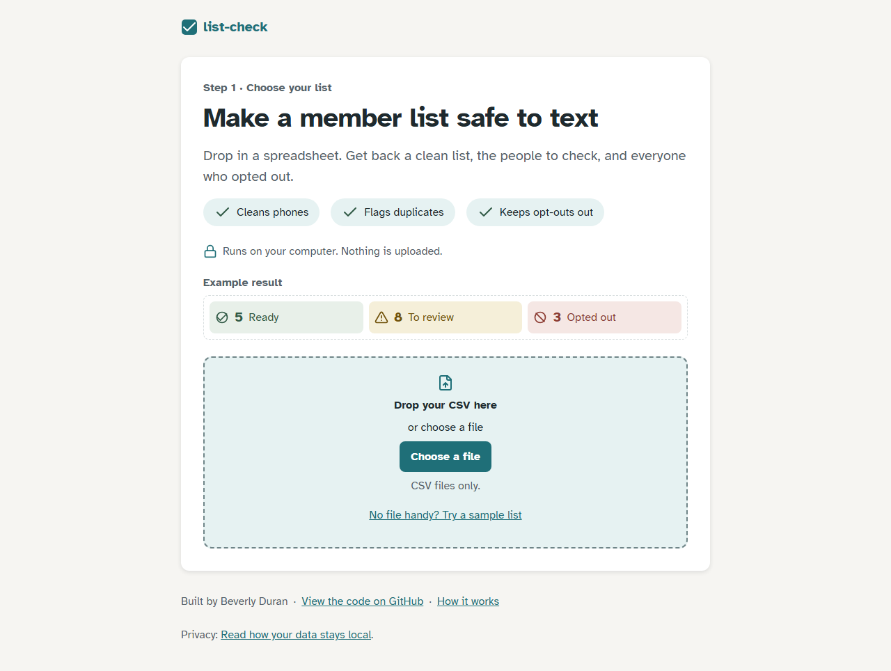
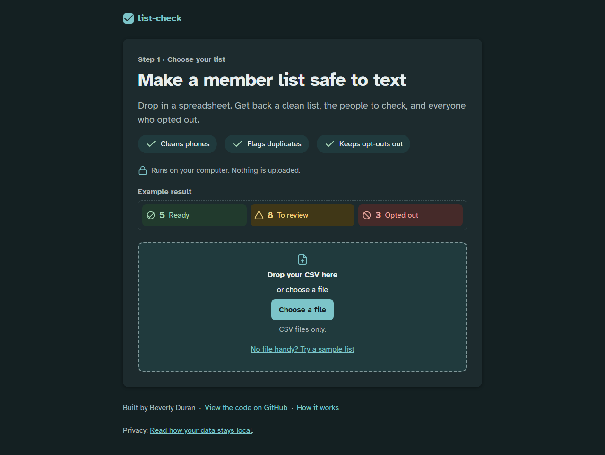

# list-check

[Try list-check](https://duranbeverly.github.io/list-check/)

A small tool for checking contact lists before texting.

| Light mode | Dark mode |
|---|---|
|  |  |

## What it does

Choose a CSV or try the sample list. list-check checks phone numbers, duplicate contacts, and opt-outs in your browser, then lets you download separate CSVs for people who are ready, people to review, and people who opted out.

If an opt-out column isn't recognized, list-check pauses before showing results. Choose the right column or confirm that the list has no opt-outs. Unfamiliar opt-out values stay in the review list.

## What it doesn't do

- It doesn't merge or remove people from your list.
- It doesn't upload your CSV or send it to a server.
- It doesn't connect to your texting platform or any account.

Your selected CSV is read in your browser. Downloads are created on your device. The sample list is a static file served by this site.

## How it works

```text
CSV file → decode text → parse rows → map columns → check people
         → ready / review / opted-out buckets → download CSVs
```

The browser reads and processes your list locally in a Web Worker, which keeps the page responsive during larger checks. Your file and results are not uploaded or sent to an account or service. The only network request involved in trying the sample is for the sample CSV hosted with this site.

## Privacy

Checking a file and creating downloads happen in your browser. The app does not send list contents to a server, and its Content Security Policy restricts connections to this site. You can verify this behavior with the privacy browser test.

## Design and voice

list-check is meant to feel calm, clear, and helpful. It talks about people, not records, and explains what to do next without blaming anyone.

The interface uses a contrast-checked palette, Atkinson Hyperlegible type, and accessibility patterns inspired by GOV.UK—including clear focus handling when a new step appears. See [BRAND.md](./BRAND.md) for the full palette, type, icons, spacing, shape, and motion rules.

## Decisions

- Shared phone groups need human review. A text to a shared number can reach multiple people, so someone should confirm who will receive it.
- If anyone sharing a phone number opts out, treat the whole number as opted out. A STOP applies to the destination number, so no one sharing it should be messaged.
- Subscription-status columns treat values such as `unsubscribed` and `stopped` as opted out, and `subscribed` and `active` as not opted out. Unfamiliar values need review.
- Duplicate groups are flags only. The tool never merges member records.
- Downloaded CSVs add apostrophes to formula-like values in original columns and reasons, but not `phone_clean`, so spreadsheets are safer while clean numbers remain importable.
- Downloads include a UTF-8 byte order mark so Excel displays accented names correctly; Papa Parse removes it when reading the CSV again.

## Limits

Files are limited to 50 MB and 500,000 rows. The app is tested with lists of up to 100,000 people; split larger lists into smaller files.

## Testing

- `npm test` runs the unit, property-based, CSV fixture, and golden-file tests.
- `npm run test:e2e` builds the production site and runs Playwright in Chromium, Firefox, and WebKit. The browser tests cover privacy, file formats, downloads, opt-out decisions, keyboard use, axe accessibility, and large-file responsiveness. Screenshot-based E2E tests are not part of the suite.
- GitHub Actions runs the unit and browser tests for changes to `main` and pull requests.

Design details, including the contrast-checked palette, Atkinson Hyperlegible type, and GOV.UK-inspired patterns, are in [BRAND.md](./BRAND.md).

## Run locally

```sh
npm ci
npm run dev
npm test
npm run test:e2e
```

Install the Playwright browsers if needed:

```sh
npx playwright install chromium firefox webkit
```

Scaffolded with [Vite](https://vite.dev/).
